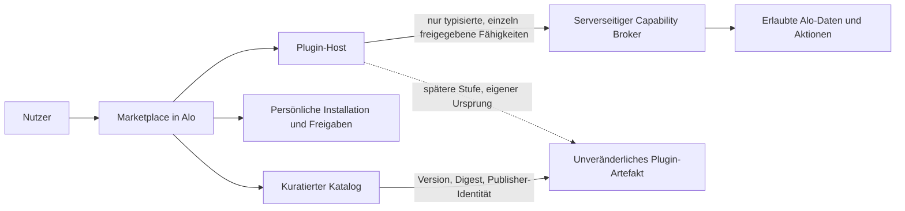

# Alo Marketplace & installierbare Plugins

## Sicherheits- und Architekturkonzept — Review-Entwurf

**Stand:** 6. November 2026 · **Basis:** Release-Snapshot `ff56d0a74067bc6db42d32368b92282ef4a806c3`
**Status:** Zwei unabhängige Read-only-Sicherheitsreviews eingearbeitet. Der eng begrenzte deklarative, Admin-only v1 wurde am 2026-11-06 freigegeben; Umsetzung läuft nur im Feature-Branch. Keine Freigabe für ausführbaren Fremdcode, Remote-Migration, Merge oder Live-Publish.

## Kurzempfehlung

Im geprüften Alo-Snapshot gibt es noch kein Marketplace- oder Plugin-System. Bereiche und Werkzeuge sind statisch in `src/lib/home-app-menus.ts` beschrieben und über `/areas` und `/tools` verlinkt. Installation und Ausführung fremden Codes wären neue Sicherheitsgrenzen, nicht nur eine weitere Kachel.

Empfohlener Weg in drei Stufen:

1. **Kuratierter, deklarativer Katalog:** Alo rendert erlaubte, feste UI-Bausteine und Aktionen selbst. Keine heruntergeladenen Skripte, HTML-Fragmente oder beliebigen Abhängigkeiten.
2. **Installieren/Deaktivieren deklarativer Plugins:** erst nach separater Produkt-/Datenmodellfreigabe; die Installation kann nur das von Alo fest implementierte und geprüfte Aktionsset aktivieren.
3. **Ausführbare Plugins:** nur als späteres, separat freizugebendes Vorhaben. Voraussetzung wären eine kontrollierte Fremd-Origin, getestete Sandbox- und Nachrichtenarchitektur, ein eng begrenzter serverseitiger Fähigkeitsvermittler und belastbare Grenzen gegen Netzwerk-, Daten- und Ressourcenmissbrauch. Ein iframe allein erfüllt diese Nachweise nicht.

Wenn beliebiger Drittanbieter-JavaScript-Code von Beginn an zwingend ist, sollte die Umsetzung blockiert bleiben, bis Isolation, Ressourcenbegrenzung, Update-/Widerrufsprozess und Verantwortlichkeiten nachgewiesen und ausdrücklich freigegeben sind.

## Bedrohungsmodell und Vertrauensgrenzen

Angreifer oder Fehlerquellen sind ein bösartiges Plugin, kompromittierte Publisherkonten oder Artefakt-Hosting, manipulierte Katalogdateien, ein kompromittiertes Nutzerkonto, ein absichtlich missbrauchender berechtigter Publisher, fehlerhafte Berechtigungen, Cross-Plugin-/Cross-User-Zugriff, Datenabfluss, SSRF im Broker sowie DoS oder Browserfehler. Getrennt zu betrachten sind Browser, Alo-Haupt-Origin, Plugin-Origin, Katalog/Artefakt-Hosting, Alo-Backend/Datenbank und externe Empfänger.

Alo ist der vertrauenswürdige Host; Plugins sind nicht vertrauenswürdig. Eine sichtbare Karte, ein clientseitiger Installationsstatus oder ein ausgeblendeter Button ist **keine** Zugriffskontrolle. Vorgabe: deny by default, Least Privilege, serverseitige Autorisierung bei jedem Zugriff und konkrete Negativtests; das entspricht den Leitlinien im [OWASP Authorization Cheat Sheet](https://cheatsheetseries.owasp.org/cheatsheets/Authorization_Cheat_Sheet.html).

## Zielbild

Katalog, persönliche Installation, Laufzeit und Broker sind getrennte Verantwortlichkeiten. Der Katalog enthält nur freigegebene Pakete. Die Installationsverwaltung hält Nutzerzustand und Grants. Der Host rendert bzw. startet die Plugin-Oberfläche. Der Broker prüft jeden Daten-/Aktionszugriff neu und führt ausschließlich eine feste Allowlist typisierter Fähigkeiten aus.

## Paket- und Publisher-Vertrauen

Ein geprüftes Manifest sollte mindestens stabile Plugin-ID, Manifestversion, Paketversion, Publisher-Identität, Klartextbeschreibung, unterstützte Alo-Version, Änderungshinweise, Datenkategorien, angeforderte Fähigkeiten, externe Ziele (falls erlaubt), Inhalts-Digest und Signatur-/Build-Herkunft enthalten. Ein strenges Schema weist unbekannte Felder oder Fähigkeiten zurück.

Artefakte und Versionen sind unveränderlich, digest-gebunden und versionsfest installiert. Keine beliebigen Paket-URLs, Nutzeruploads oder dynamischen Abhängigkeiten im Startumfang. Veröffentlichung erfordert menschliche Prüfung, Dependency-/Malware-/Secret-Prüfungen, Komponenteninventar/SBOM und dokumentierten Build-/Herkunftsnachweis. [OWASP](https://cheatsheetseries.owasp.org/cheatsheets/Software_Supply_Chain_Security_Cheat_Sheet.html) empfiehlt Integritätsprüfung, Signierung und laufende Überwachung; [Sigstore](https://docs.sigstore.dev/cosign/verifying/verify/) beschreibt die Verifikation von Signatur, Identität und Artefakt-Digest. Eine gültige Signatur belegt weder Gutartigkeit noch Datenschutzkonformität.

Vor Drittanbieterbetrieb sind Schlüsselhierarchie, Schutz, Rotation, Kompromittierungswiderruf, Audit/Transparenz, Anti-Downgrade, Incident-Verantwortung und Offline-Verhalten festzulegen. Bei unbekanntem oder veraltetem Widerrufsstatus darf ein ausführbares Plugin nicht stillschweigend weiterlaufen. Eine Sofortsperre muss laufende Instanzen beenden können.

## Berechtigungen und Datenschutz

Berechtigungen gelten getrennt nach Nutzer, Plugin, Installationsinstanz, Version und Aktion; Workspace-/Geräte-Grenzen sind vor Datenmodellfreigabe festzulegen. Serveridentität wird aus der gültigen Alo-Sitzung abgeleitet, nie aus einer Plugin-Nutzer-ID. Kein Recht ist implizit. Installieren gewährt nicht automatisch sensible Daten- oder Netzwerkrechte. Chrome-Erweiterungen verwenden optionale Laufzeitberechtigungen als Beispiel für informierte, bedarfsbezogene Einwilligung; das ist hier eine Analogie, keine fertige Sicherheitsarchitektur ([Chrome-Dokumentation](https://developer.chrome.com/docs/extensions/develop/concepts/declare-permissions)).

Die Berechtigungsanzeige nennt Zweck, betroffene Daten, Empfänger/Ziel, Zeitpunkt, Dauer und Widerruf. „Übermitteln“ und „dauerhaft berechtigt sein“ sind verschiedene Entscheidungen: Eine einmalige Nutzerfreigabe autorisiert nicht spätere Übertragungen. Für jeden sensiblen Export muss der Nutzer den konkreten Inhalt und Empfänger sehen und bewusst senden; diese Zustimmung ersetzt keine technische Begrenzung möglicher Datenkanäle.

„Ohne Berechtigung“ bedeutet nur öffentliche Plugin-Metadaten und rein lokale UI-Navigation. Jede Aktion, die Daten liest, speichert, verändert, löscht, eine Nachricht sendet, ein Training auslöst, Kosten erzeugt oder Alo-Daten offenlegt, braucht eine eigene Capability und je nach Risiko eine erneute Bestätigung.

Datenkategorien sind vor Zugriff einzeln zu klassifizieren: Gesundheit/Messwerte, Training und Körperwerte, Nexus-Nachrichten, Räume und Mitglieder, Anhänge, Sprachtranskripte, Erinnerungen, Profil-/Verhaltensmetadaten sowie abgeleitete Profile/Ausgaben. Auch Metadaten und Ableitungen können sensibel sein. Für jeden Zweck sind Umfangsminimierung, Empfänger, Aufbewahrung, Löschung und eine gesonderte Datenschutz-/Rechtsprüfung zu klären. Mira erhält Trainings-, Gesundheits- oder Nexus-Daten und Anhänge nie stillschweigend aus einer Plugin-Freigabe.

Vorgeschlagene Rechte-Stufen:

- **Kein Datenrecht:** öffentliche Katalogbeschreibung; Alo-interne Navigation.
- **Eigener Plugin-Speicher:** separat pro Nutzer, Plugin und Installationsinstanz; Größenlimit; kein Lesen fremder Plugin-Speicher.
- **Alo-Daten:** nur eng bestimmte Operationen, z. B. ein vom Nutzer ausgewähltes Training lesen, nicht pauschal „Training lesen“. Sensible Daten nur nach gesonderter, kontextbezogener Freigabe.
- **Netzwerk:** standardmäßig gesperrt. Externe Verarbeitung nur über dedizierte, feste und überprüfte Integrationen; keine beliebige URL und kein generischer Proxy.

Plugins erhalten nie Alo-Cookies/-Tokens, Provider- oder Supabase-Schlüssel, den direkten Supabase-Client, App-Storage, generische RPC- oder Datenbankrechte. Plugin-Storage und Grants sind strikt pro Nutzer/Plugin/Installation getrennt. Jede Objekt-ID wird gegen den aus der Sitzung abgeleiteten Nutzer und die aktuelle Installation geprüft; RLS allein reicht nicht, insbesondere bei Service-Role-Zugriffen des Brokers. Logs/Audit enthalten nur notwendige Metadaten, keine Inhalte, Anhänge, Tokens oder Geheimnisse. Kontowechsel beendet Plugin-Sitzungen und verwirft sitzungsgebundene Daten.

## Broker und Netzwerkgrenzen

Der Broker ist kein URL-Fetch-Proxy. Er bietet nur versionierte Capability-IDs mit festen Eingabe-/Ausgabeschemata, Limits, Zeitüberschreitungen, Quoten, Idempotenz-/Replay-Schutz und Audit-Metadaten. Authentifizierung, Besitz, Installation, aktuelle Grants und Zweck werden bei jedem Aufruf serverseitig geprüft. Fehler verweigern standardmäßig und legen keine Secrets oder internen Details offen.

Wenn eine konkrete Integration ausgehende Netzaufrufe braucht, ist das ein eigener Ausführungspfad mit festem Dienst-/Hostvertrag. Eine Host-Allowlist allein ist keine SSRF-Abwehr. Vor Freigabe müssen Protokoll und Port begrenzt, DNS zur Verbindungszeit geprüft, Loopback-/private-/link-local-/Metadata-IP-Adressen blockiert, DNS-Rebinding verhindert, TLS-Zertifikate geprüft und Redirects unterbunden oder für jeden Hop vollständig neu validiert werden. Antwortgröße, Laufzeit, Inhaltstyp und Weitergabe an das Plugin sind zu begrenzen; Alo-Cookies und Credentials werden nie weitergereicht. Keine ungeprüfte beliebige IP, URL, Header oder Redirect-Ziele.

## Ausführbarer Plugin-Code — spätere Stufe, derzeit blockiert

Fremder Code läuft weder im Alo-Hauptfenster/Alo-Origin noch auf dem Server. Node.js warnt ausdrücklich, dass [`node:vm`](https://nodejs.org/api/vm.html) kein Sicherheitsmechanismus für nicht vertrauenswürdigen Code ist.

Ein möglicher Browser-Prototyp müsste einen kontrollierten, von Alo getrennten Plugin-Origin verwenden und einen cross-origin `<iframe sandbox="allow-scripts">` **ohne** `allow-same-origin`, Pop-ups, Formulare, Downloads oder Top-Level-Navigation testen. Das [`iframe`-Sandbox-Attribut](https://developer.mozilla.org/en-US/docs/Web/HTML/Reference/Elements/iframe) und die HTTP-Headerdirektive [CSP `sandbox`](https://developer.mozilla.org/en-US/docs/Web/HTTP/Reference/Headers/Content-Security-Policy/sandbox) sind zwei verschiedene Kontrollpunkte. Ohne `allow-same-origin` bekommt der Inhalt eine opake Origin. Alo muss zusätzlich sicherstellen, dass Plugin-Inhalte nicht außerhalb des Frames oder in einem neuen Tab ausgeführt werden. MDN warnt, dass Sandbox keine ausreichende Grenze ist, wenn nicht vertrauenswürdige Inhalte außerhalb des sandboxed Frames angezeigt werden.

Eine mögliche restriktive Richtlinie muss als Ganzes entworfen und getestet werden, nicht als einzelne `connect-src`-Annahme: Eltern-App `frame-src` nur auf den kontrollierten Plugin-Origin beschränken ([MDN `frame-src`](https://developer.mozilla.org/en-US/docs/Web/HTTP/Reference/Headers/Content-Security-Policy/frame-src)); Plugin-Inhalt erhält passende Regeln für `default-src`, `script-src`, `img-src`, `style-src`, `form-action`, `object-src`, `base-uri`, `frame-ancestors` und `connect-src`. `connect-src 'none'` sperrt bestimmte Script-Verbindungen wie `fetch`, XHR, WebSocket und `sendBeacon`, **nicht automatisch jeden Abflussweg**. Ressourcen, Formulare und Navigation sind separat zu behandeln ([MDN `connect-src`](https://developer.mozilla.org/en-US/docs/Web/HTTP/Reference/Headers/Content-Security-Policy/connect-src)). Das `iframe`-Sandbox-Attribut beschränkt außerdem nicht von sich aus beliebige ausgehende Ressourcenanfragen. Wenn der Broker die einzige Netzwerkschnittstelle sein soll, muss die vollständige, browsergetestete CSP direkte Verbindungen und andere Abflusswege ausreichend begrenzen. Konkrete Origins/Headers sind offen, bis Hosting und Sicherheitsreview feststehen.

Ein Nachrichtenkanal ist Transport, kein Identitätsnachweis. Bei opaker iframe-Origin kann `event.origin` typischerweise `"null"` sein; eine normale Publisher-Origin-Prüfung reicht dann nicht. [MDN `postMessage`](https://developer.mozilla.org/en-US/docs/Web/API/Window/postMessage) verlangt Sender-/Source- und Inhaltsprüfung sowie möglichst genaues `targetOrigin`; ungezieltes `"*"` kann Daten offenlegen. Ein `MessageChannel`/Einmal-Nonce ist daher nur ein zu prüfender Vorschlag, keine bereits sichere Lösung. Vor sensiblen Capability-Nachrichten muss der Host das erwartete Dokument/Frame zuverlässig binden, Source und Schema validieren und Navigation, Reload, Race, Replay, Konto-/Versionswechsel sowie sofortigen Port-Entzug testen. Falls ein Wildcard-Target für eine opake Origin technisch nötig ist, darf der Bootstrap höchstens nicht-sensible Daten an das exakt gehaltene Frame-Fenster geben; danach nur über einen begrenzten Kanal. Solange diese Bindung nicht bewiesen ist, werden keine sensiblen Daten oder Capabilities übertragen.

Sandboxing ist keine harte CPU-/Speichergrenze: eine Endlosschleife kann mindestens den Tab beeinträchtigen. Ein iframe allein liefert kein belastbares Ressourcenlimit. Phase 3 bleibt blockiert, bis ein Prototyp nachweisbar abbrechbar und begrenzt ist und UI-DoS-/Browserfehler-Fälle besteht. Wenn das im Web nicht verlässlich erreichbar ist, muss ausführbarer Fremdcode entfallen.

## Installation, Updates und Entfernung

1. Vor Installation zeigt Alo Publisher, feste Version, Zweck, Datenkategorien, Fähigkeiten, Empfänger und Review-/Änderungshinweise.
2. Manifest, Digest, Signatur, Publisherstatus und Widerrufsstatus werden geprüft. Jeder Fehlschlag blockiert die Ausführung.
3. Installation ist an Nutzer, Plugin und Installationsinstanz gebunden. Sie vergibt nur ausdrücklich bestätigte, eng begrenzte Rechte.
4. Updates verwenden neue, unveränderliche Versionen. Keine stille Code- oder Rechteausweitung; Berechtigungsänderungen und externe Empfänger werden separat bestätigt. Widerruf beendet laufende Instanzen.
5. Bei Offlinebetrieb oder nicht erreichbarem Widerrufsstatus gelten festgelegte Ablaufzeiten; unbekannter Status darf nicht als „vertrauenswürdig“ interpretiert werden. Rückstufung auf eine verworfene/verwundbare Version ist blockiert.
6. Deaktivierung beendet die Instanz und sperrt Brokerzugriffe. Deinstallation widerruft Grants. Export/Löschung plugin-eigener Daten, Serverkopien, Logs, Backups und externe Kopien müssen transparent geregelt werden; eine externe Kopie kann Alo nicht automatisch löschen.

## Empfohlene Einführungsphasen

- **Phase 0 — Konzept:** Produkt-, Daten- und Trust-Entscheidungen, Datenschutzprüfung und Incident-Verantwortung klären.
- **Phase 1 — Katalog ohne Installation/Ausführung:** kuratierte Einträge als Alo-gerenderte Metadaten und Links; noch keine persistente Installation, Datenrechte oder fremden Skripte.
- **Phase 2 — Deklarative Installation:** erst nach eigener Freigabe Installationszustand, RLS/Serververtrag, UI, Export/Löschung, Missbrauchsschutz und Tests planen. Keine Migration ist durch dieses Konzept autorisiert.
- **Phase 3 — Ausführbare Plugins:** gesonderte Architekturfreigabe; isolierter Origin, vollständige CSP, Nachrichtenprotokoll, Broker, Supply-Chain-Verifikation und belastbare Verfügbarkeits-/Abbruchnachweise in einer isolierten Probe validieren. Bis dahin keine echten Fremd-Plugins und keine Nutzerdaten.

## Harte Freigabegates vor Implementierung

- Sicherheitsreview und Datenklassifizierung sind abgenommen; Rollen, Trust Boundaries und Verantwortliche sind dokumentiert.
- Unsigned, veränderte, unbekannte, downgradete oder zurückgezogene Pakete fail-closed blockiert; Rotation, Widerruf, Offline-Freshness und Notfallsperre getestet.
- Server leitet Nutzeridentität aus Session ab; User-/Plugin-/Installationsisolation, Sessionwechsel, RLS sowie mögliche Service-Role-Pfade sind geprüft.
- Jede Capability wird serverseitig erneut autorisiert; unberechtigte Zugriffe, Objekt-ID-Manipulation, Cross-User-/Cross-Plugin-Zugriff, Replay, Quoten und sofortiger Entzug sind getestet.
- Direkte Plugin-Netzwerkwege und alle Ressourcen-/Formular-/Navigationspfade sind mit einer vollständigen, browsergetesteten CSP-Policy begrenzt.
- Ein Broker mit externen Requests blockiert SSRF-Vektoren einschließlich Redirects, DNS-Rebinding und private/Metadata-IP-Ziele; Antwortgrößen und Laufzeit sind begrenzt.
- Sandbox-, Nachrichten-Bootstrap-, Navigation-Race-, Port-Entzug-, Browserfehler- und Ressourcenmissbrauchstests bestehen. Wenn belastbare DoS-Grenzen nicht belegbar sind, keine ausführbaren Plugins.
- Update-/Rollback-/Uninstall-/Backup-/Incident-Verhalten ist erklärt und geprüft; Datenschutz-/Rechtsprüfung für sensible und externe Verarbeitung ist abgeschlossen.
- Mobile UI, Tastatur/Screenreader, 320/390 px und Alo-Design-/Navigationseinstellungen bleiben erhalten.

## Noch zu entscheidende Produktfragen

1. Sind Publisher zuerst ausschließlich Alo-intern, oder sollen externe Anbieter von Beginn an mitmachen?
2. Reicht ein installierbares, aber deklaratives Plugin, oder ist ausführbarer JavaScript-Code zwingend?
3. Welcher erste konkrete Anwendungsfall rechtfertigt welche Datenrechte? Für den Start empfohlen: keine sensiblen Daten.
4. Gibt es einen separat kontrollierbaren Plugin-Origin, Artefaktspeicher und überprüfbare CSP-Header? Das ist im geprüften Stand nicht belegt.
5. Wer prüft Publisher/Versionen, schützt und widerruft Signierschlüssel, überwacht Schwachstellen, nimmt Sicherheitsmeldungen an und sperrt Plugins global?
6. Welche Offline-, Updates-, Nutzerexport-, Lösch-, Backup- und Aufbewahrungsregeln gelten?
7. Welche rechtliche/Datenschutzprüfung ist für Gesundheits-, Trainings- und Chatdaten sowie externe Empfänger nötig?

Dieser Statussatz hielt den Stand vor der späteren Freigabe fest: Damals waren weder Marketplace-Publikationsschema noch Plugin-API eingerichtet. Die nachfolgend beschriebenen v1-Artefakte liegen ausschließlich im Feature-Branch; die Migration wurde nicht angewendet.

## Nachtrag: freigegebene deklarative v1 (2026-11-06)

Die vorangehende Einschätzung „nicht freigegeben“ beschreibt den Stand vor Hendriks ausdrücklicher Freigabe der eng begrenzten v1. Freigegeben ist ausschließlich ein Admin-only-Autorenfluss für typisierte JSON-Manifeste aus festen React-Blöcken und bestehenden Alo-Routen/Werkzeugen/Spielen. Entwürfe und persönliche, versionsgebundene Installationen bleiben lokal; Mira erhält nur das vom Admin ausdrücklich eingegebene Ziel, keinen Verlauf und keine Gesundheits-/Trainingsdaten. Veröffentlichungen und Widerrufe verlangen eine explizite Bestätigung. Versionen sind unveränderlich; Widerruf blockiert weitere Server-Lese- und Startprüfungen. Alle Admin-Zugriffe werden serverseitig und mit RLS anhand der bestehenden globalen Admin-Rolle geprüft; Rollenverwaltung bleibt unangetastet. Ausführbarer Fremdcode, HTML/JavaScript, externe Provider/Netzwerkrechte und beliebige Datenrechte bleiben ausgeschlossen.

Der genehmigte Stand liegt im Feature-Branch `cue/marketplace-mira-authoring-20261106` auf dem Snapshot-Merge `66d872fc4da36fdf052626aea546301a2e46f7d8`. Die vorbereitete Migration `supabase/migrations/20261106223000_marketplace_authoring_v1.sql` wurde weder lokal gegen eine Datenbank noch remote angewendet; es wurde kein Datenbankziel geändert. Repository-`supabase/config.toml` und lokale `.env` verweisen auf `dbnlybjlswuvxrccgqah`, ebenso der Issuer in `.lovable/mcp/manifest.json`; ältere Roadmap-Aufzeichnungen verbinden diese Referenz mit der damaligen Lovable-Cloud. Das Projekt ist in der aktuell verbundenen Supabase-Projektliste nicht enthalten, daher sind aktuelle Aktivität, Rollen-/Migrationszustand und die Übereinstimmung mit dem veröffentlichten Build nicht verifiziert. Keine Migration, kein Merge und kein Live-Publish.

Lokale Prüfungen: `npm test` 573/573 bestanden, TypeScript, Produktionsbuild, Prettier der geänderten Quell-/Testdateien und `git diff --check` bestanden; ESLint 0 Fehler und 18 bestehende Warnungen. Zwei unabhängige Read-only-Reviews ohne verbleibenden Blocker; die Datenbank- und Client-Validatoren weisen nun auch dieselben Bidi-Steuerzeichen ab. Der 500-Einträge-Grenzwert wird beim Erstellen unter transaktionalem Advisory Lock serverseitig eingehalten. Eine echte angemeldete Browser-/Geräteabnahme und ein Datenbank-Integrationstest wurden nicht ausgeführt.
